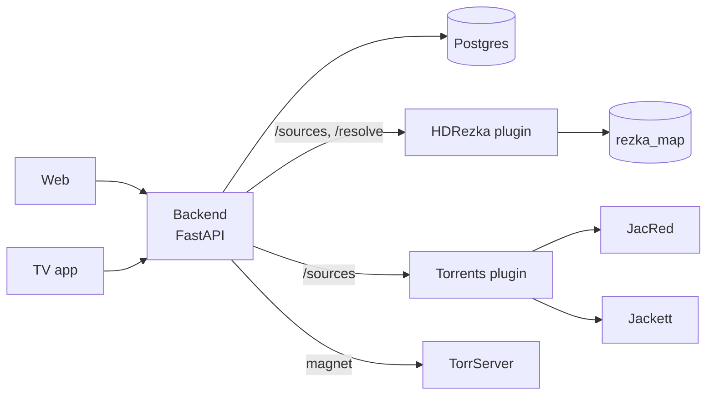

<p align="center">
  
</p>

<h1 align="center">Nestify</h1>

<p align="center">
  A private home cinema for the browser and the TV.<br/>
  Pick a film, press Play, and it starts: the voice-over, quality and next episode are chosen for you.
</p>

<p align="center">
  <a href="#how-it-works">How it works</a> ·
  <a href="#repository">Repository</a> ·
  <a href="#run-it-locally">Run it locally</a> ·
  <a href="#deploy">Deploy</a> ·
  <a href="#documentation">Documentation</a>
</p>

---

## What it does

- **One button.** Play starts the best source at once and remembers the voice-over per series, so
  nobody in the family has to choose anything.
- **Extensions.** Sources come from server-side plugins, like Lampa's but running on your server.
  An account installs an extension once and every profile in it gets it.
- **Profiles.** Netflix-style "who's watching", per-profile history and "continue watching".
- **Web and TV.** A React site and a TV app for Android TV with D-pad navigation and a native
  ExoPlayer. A phone can send a film to the TV.
- **A real player.** Voice-over, episodes and quality in one place, the next episode card, fast
  seeking through a proxied stream.

## How it works



1. The client asks the backend for sources of a TMDB title.
2. The backend asks every plugin installed on the account, in parallel, and merges the answers.
3. Right before playback the backend resolves the chosen source. Links tied to the server's IP are
   streamed through the backend, torrents go to TorrServer and come back as HLS.

Plugins are separate HTTP services with a small protocol, described in
[docs/plugins.md](docs/plugins.md). The client never talks to them directly.

## Repository

```text
backend/            FastAPI API: accounts, profiles, playback, plugins, TV pairing, websockets
web/                React + Vite site
tv/                 TV version of the site and the Android TV shell (WebView + ExoPlayer)
plugins/rezka/      HDRezka source plugin
plugins/torrents/   Torrent search plugin (JacRed, Jackett, domem)
jacred/             Own JacRed instance for torrent search
infra/              Compose files for infrastructure services
docs/               Plugin protocol and infrastructure
```

| Part | Stack |
|---|---|
| Backend | Python 3.11, FastAPI, SQLAlchemy 2 (async), Postgres, httpx |
| Web and TV | React 19, Vite 5, React Router 7, Swiper |
| Android TV | Capacitor shell, ExoPlayer |
| Plugins | FastAPI, HdRezkaApi, psycopg |
| Streaming | TorrServer, ffmpeg for HLS |

## Run it locally

**Backend** (needs Postgres):

```bash
cd backend
cp .env.example .env            # DATABASE_URL, AUTH_SECRET_KEY, TMDB_KEY, ...
pip install -r requirements.txt
uvicorn app.main:app --reload   # http://localhost:8000
```

Tables are created at startup.

**Web:**

```bash
cd web
cp .env.example .env.local      # VITE_BACKEND_URL, VITE_TMDB_KEY
npm install
npm run dev                     # http://localhost:5173
```

Point `VITE_BACKEND_URL` at a running backend, local or production.

**TV:** the same steps in `tv/`, it runs on port 5174. See [tv/README.md](tv/README.md).

**Plugins:** each one is a small FastAPI app, see its README.

## Deploy

Everything runs on one server in [Dokploy](https://dokploy.com), one application per folder. A
push to `main` redeploys the apps whose files changed. The backend reaches plugins, TorrServer and
the databases over the internal Docker network, so none of them needs a public port.

Details and the list of services are in [docs/infrastructure.md](docs/infrastructure.md).

## Documentation

| Document | What's inside |
|---|---|
| [docs/plugins.md](docs/plugins.md) | Plugin protocol, settings, backend API for plugins and extensions |
| [docs/infrastructure.md](docs/infrastructure.md) | Services, networking, deploy and security notes |
| [backend/README.md](backend/README.md) | Backend structure, configuration and tests |
| [web/README.md](web/README.md) | Web client structure and conventions |
| [tv/README.md](tv/README.md) | TV client and the Android bridge |
| [plugins/rezka/README.md](plugins/rezka/README.md) | HDRezka plugin: title matching, cookies, qualities |
| [plugins/torrents/README.md](plugins/torrents/README.md) | Torrent search plugin |

## Tests

```bash
cd backend && python -m pytest tests                  # backend
cd plugins/rezka && python -m pytest tests            # HDRezka plugin
cd plugins/torrents && python -m pytest tests         # torrents plugin
node --test web/src/core/*.test.js                    # web playback logic
```

## Acknowledgements

- [HdRezkaApi](https://github.com/SuperZombi/HdRezkaApi)
- [jac.red](https://github.com/YouROK/jac.red)
- [TorrServer](https://github.com/YouROK/TorrServer)
- [Jackett](https://github.com/Jackett/Jackett)
- [TMDB](https://www.themoviedb.org) for metadata and images. This product uses the TMDB API but is
  not endorsed or certified by TMDB.
