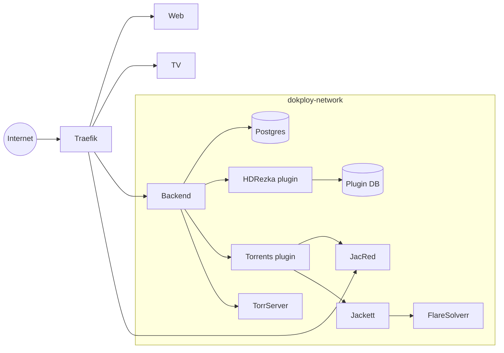

# Infrastructure

Nestify runs on one server under [Dokploy](https://dokploy.com). Each folder of the repository is
its own Dokploy application with its own build, environment and lifecycle.

## Services

| Service | Source | Public | Role |
|---|---|---|---|
| Web | `web/` | yes | The site, built by Vite and served by nginx |
| TV | `tv/` | yes | The TV site loaded by the Android shell |
| Backend | `backend/` | yes | The API every client talks to |
| HDRezka plugin | `plugins/rezka/` | no | Finds and resolves HDRezka sources |
| Torrents plugin | `plugins/torrents/` | no | Searches JacRed, Jackett and domem |
| Postgres | Dokploy database | no | Accounts, profiles, history, plugins |
| Plugin database | Dokploy database | no | `rezka_map` and the HDRezka plugin's saved settings |
| TorrServer | `ghcr.io/yourok/torrserver` | no | Turns a magnet link into a stream |
| JacRed | `jacred/` | yes | Torrent index for Ukrainian and Russian releases, with its own web page |
| Jackett | `ghcr.io/linuxserver/jackett` | no | Torrent search for English and Polish releases |
| FlareSolverr | `ghcr.io/flaresolverr/flaresolverr` | no | Helps Jackett with sites behind Cloudflare |

## Networking

Only the web, TV, backend and JacRed apps have domains. Everything else is reached by its service name over
`dokploy-network`, for example `http://torrserve:8090`, and must not publish a port on the host.

TorrServer in particular has no authentication: anyone who can reach it can add torrents or shut
it down. Video reaches users only through the backend, which proxies TorrServer and HLS.

## Deploy

A push to `main` redeploys the applications whose files changed, one after another, which takes
about 10 to 15 minutes for everything. Plugin apps watch only their own folder
(`plugins/rezka/**`, `plugins/torrents/**`).

The backend creates missing tables at startup but does not run Alembic. A new column on an existing
table needs its migration applied by hand before that deploy.

### A new plugin

1. Create an Application from its folder (build type Dockerfile, no domain).
2. Set `PLUGIN_TOKEN` and the plugin's other variables.
3. In Nestify, as an admin: Профіль → Розширення → Додати за посиланням, with
   `http://<app name>:8000/manifest.json` and the token.

The plugin is then installed on every account.

## HDRezka cookies

The site checks for bots and ties its cookie to the IP that passed the check, so the cookie has to
come from a browser going through the server. It lasts about 30 days.

Admins see the expiry date on the extensions page, with a warning five days before it runs out.
"Налаштувати" on the HDRezka card shows the renewal steps, checks new cookies against the site and
saves them in the plugin's database, without a redeploy. See
[plugins/rezka/README.md](../plugins/rezka/README.md).

## Secrets

Secrets live only in Dokploy's environment settings, never in the repository. `.env.example` files
list the variables with empty or placeholder values, and local `.env` and `.env.local` files are
ignored by git.
