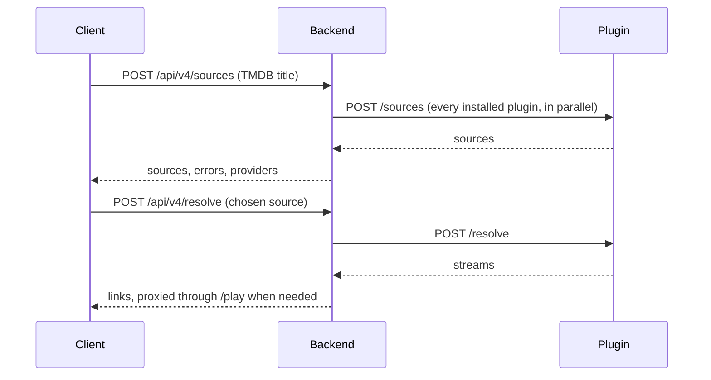

# Source plugins

A source plugin is a separate HTTP service that finds video for a title. Nestify asks the plugins
installed on an account for sources and plays what the user picks.

Plugins run on the server, never in the client. That is what makes sources tied to the server's IP
or to a session cookie work, and a plugin never sees a user's session.



Existing plugins: [HDRezka](../plugins/rezka/README.md) and [Torrents](../plugins/torrents/README.md).

## Install, remove, configure

| Who | Where | What |
|---|---|---|
| Admin | Профіль → Розширення → Додати за посиланням | Adds a plugin by its manifest URL and token. It is then installed on every account |
| Any account | Профіль → Розширення | Removes or installs it again. The choice holds for all profiles of that account |
| Admin | Розширення → Налаштувати | Settings and status, for plugins that have them |

An admin is an account with a profile whose role is `admin`.

## Protocol (version 1)

If the plugin was installed with a token, every request carries `Authorization: Bearer <token>`.
Responses are JSON with status 200. Redirects are not followed.

The manifest must be served at a path ending in `/manifest.json`. The other methods are relative to
the same directory.

### `GET /manifest.json`

```json
{
  "id": "rezka",
  "name": "HDRezka",
  "version": "1.0.0",
  "api_version": 1,
  "description": "Optional",
  "kinds": ["direct"]
}
```

`id` is lowercase letters, digits, `-` and `_`, and must not change between versions.

`kinds` lists what the plugin returns. Nestify asks only the plugins with a kind it needs at that
moment. The Play button asks for `direct` and `hls` and must be fast. The source picker asks for
`torrent` and `embed`, which may take up to 70 seconds. So `kinds` must be accurate.

### `POST /sources`

Only `media_type` and `title` are always present. `season` and `episode` are sent for series.
`titles` holds names in other languages, for example `{"en": "...", "pl": "..."}`.

```json
{
  "media_type": "tv",
  "title": "Лучше звоните Солу",
  "original_title": "Better Call Saul",
  "year": 2015,
  "tmdb_id": "60059",
  "imdb_id": "tt3032476",
  "season": 1,
  "episode": 1
}
```

`id` in the answer is opaque to Nestify and comes back in `/resolve`, so it must carry whatever the
plugin needs to find the source again, season and episode included.

```json
{
  "sources": [
    {
      "id": "7769:238:1:1",
      "title": "Оригинал (+субтитры)",
      "kind": "direct",
      "voice": "Оригинал",
      "quality": "1080p",
      "language": "en",
      "size_bytes": 1047039930,
      "seeders": 10
    }
  ]
}
```

Only `id`, `title` and `kind` are required. At most 1000 sources per plugin are used, and a response
may be up to 4 MB.

`extra` is an optional object passed to the client as is. For `torrent` it holds `magnet` and may
hold `voices`, `videotype`, `peers`, `pub_date` and `tracker`. For `embed` it holds `embed`, the
player data. `language` for torrents is `uk`, `ru`, `en` or `pl`, the tabs of the source picker.

### `POST /resolve`

Called right before playback, so links may be short-lived. Request: `{"source_id": "7769:238:1:1"}`.

```json
{
  "kind": "direct",
  "playback": "proxy",
  "streams": [
    {"quality": "1080p", "url": "https://cdn.example/v.mp4", "headers": {"Referer": "https://example"}}
  ],
  "subtitles": [
    {"lang": "ru", "label": "Русский", "url": "https://cdn.example/ru.vtt"}
  ]
}
```

| `kind` | Required field | Meaning |
|---|---|---|
| `direct` | `streams` | A video file |
| `hls` | `streams` | An HLS playlist |
| `torrent` | `magnet` | A magnet link, played through TorrServer |
| `embed` | `embed_url` | A page to embed |

| `playback` | Meaning |
|---|---|
| `direct` | The client fetches `url` itself. `headers` are not allowed |
| `proxy` | Nestify fetches `url` and streams it to the client, which never sees the URL or `headers`. Only for `kind: direct` |

Use `proxy` when a link works only from the server's IP or needs custom headers.

A response that breaks these rules is rejected, and the error is reported for that plugin only.

### `GET /settings` and `PUT /settings` (optional)

A plugin with settings gets a "Налаштувати" button and a status line on the extensions page, for
admins only. Plugins without settings answer 404 and get neither.

```json
{
  "status": {"ok": true, "message": "Сайт приймає куки", "expires_at": 1796467337},
  "fields": [{"key": "cookies", "label": "Куки", "placeholder": "Вставте значення cookie"}],
  "help": [{"text": "Відкрийте тунель:", "command": "ssh -D 1080 -N root@server"}]
}
```

| Field | Meaning |
|---|---|
| `status.ok` | `false` shows the message in red |
| `status.expires_at` | Unix time. The page shows the date and warns five days before |
| `fields` | Text boxes the admin fills in |
| `help` | Numbered steps; `command` gets a copy button |

`PUT` receives `{"values": {"cookies": "..."}}` and answers with the same object as `GET`. To refuse,
answer 400 with `{"detail": "..."}`: the text is shown to the admin, so make it say what to do.

Never return saved secrets from either method.

## A minimal plugin

```python
from fastapi import FastAPI

app = FastAPI()

@app.get("/manifest.json")
def manifest():
    return {"id": "example", "name": "Example", "version": "1.0.0", "api_version": 1, "kinds": ["direct"]}

@app.post("/sources")
def sources(body: dict):
    return {"sources": [{"id": "trailer", "title": "Trailer", "kind": "direct"}]}

@app.post("/resolve")
def resolve(body: dict):
    return {"kind": "direct", "playback": "direct",
            "streams": [{"quality": "720p", "url": "https://cdn.example/trailer.mp4"}]}
```

A real plugin also checks the bearer token, see `plugins/rezka/app.py`.

## Backend API

All under `/api/v4`.

| Method | Path | Access | Purpose |
|---|---|---|---|
| `GET` | `/plugins` | admin | List plugins. Tokens are never returned |
| `POST` | `/plugins` | admin | Install: `{"manifest_url", "token"}` |
| `PATCH` | `/plugins/{id}` | admin | `{"enabled"}` and/or `{"token"}`. An empty token removes it |
| `POST` | `/plugins/{id}/refresh` | admin | Re-read the manifest |
| `DELETE` | `/plugins/{id}` | admin | Remove for everyone |
| `GET` | `/extensions` | account | The extensions page: plugins, their state on this account, admin status |
| `PUT` | `/extensions/{id}` | account | `{"installed"}` for this account |
| `GET`, `PUT` | `/extensions/{id}/settings` | admin | Read and save a plugin's settings |
| `POST` | `/sources` | account | Ask this account's plugins, optionally only for some `kinds`. Returns `{"sources", "errors", "providers"}` |
| `POST` | `/resolve` | account | `{"plugin_id", "source_id"}`. Returns `{"kind", "streams", "subtitles", "magnet", "embed_url"}` |
| `GET` | `/play/{token}` | the link | Streams proxied media with `Range` support |
| `GET` | `/playback` | profile | Where to start a title: remembered voice-over and progress |
| `PUT` | `/playback/voice` | profile | Remember the voice-over chosen for a title |

`/play` links are random, live for 6 hours and are kept in memory, so a backend restart invalidates
them and the client calls `/resolve` again. This needs the backend to run as one process.

Installing a plugin means trusting it: the backend calls its URLs and, with `proxy`, fetches
whatever URLs it returns. That is why only admins can install plugins.

## Tests

```bash
cd backend
pip install -r requirements.txt -r requirements-dev.txt
python -m pytest tests
```
